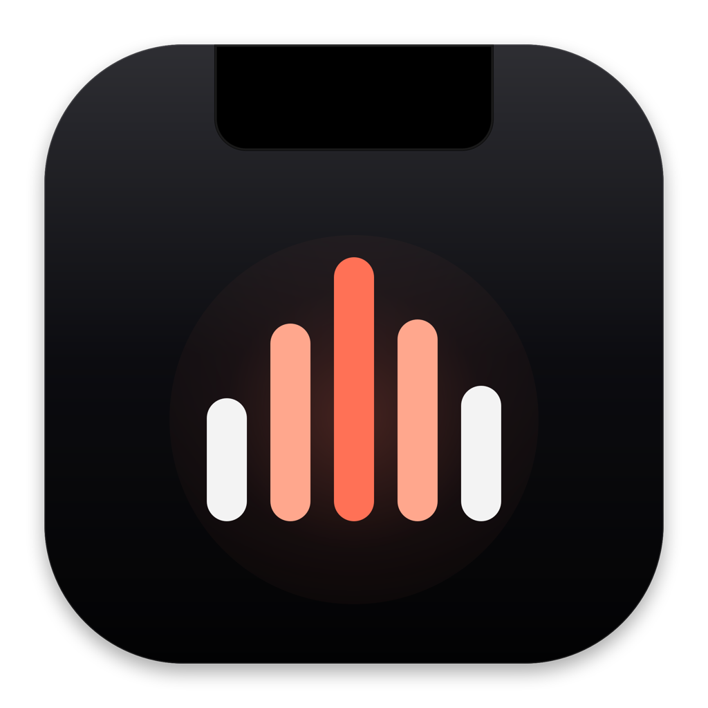

<p align="center">
  
</p>

# NotchMusic

一个在 MacBook 刘海区域显示 Apple Music 当前播放歌曲的开源 macOS 工具。

## 当前 MVP

- macOS 14+
- 仅支持有刘海的内建屏幕
- 仅支持 Apple Music
- 显示封面、歌曲名、歌手、专辑和播放进度
- 支持上一首、播放/暂停和下一首
- 支持拖动播放进度
- 支持调节 Apple Music 音量
- 未播放时收起宽度与内建刘海一致
- 鼠标短暂悬停或点击后弹簧展开，移出收起
- 不使用 Accessibility、Screen Recording 或私有 API

## 构建

用 Xcode 打开 `NotchMusic.xcodeproj`，选择 `NotchMusic` scheme 后运行。

也可以从命令行构建：

```bash
xcodebuild \
  -project NotchMusic.xcodeproj \
  -scheme NotchMusic \
  -configuration Debug \
  -derivedDataPath .build \
  build
```

构建完成后运行：

```bash
open .build/Build/Products/Debug/NotchMusic.app
```

## 首次使用

1. 启动 NotchMusic。
2. 在刘海面板或菜单栏菜单中选择“连接 Apple Music”。
3. 在系统提示中允许 NotchMusic 控制 Apple Music。
4. 打开 Apple Music 并播放歌曲。

如果误拒绝了权限，可以在“系统设置 → 隐私与安全性 → 自动化”中重新开启。

## 实现说明

应用通过 AppleScript 自动化接口读取 Apple Music 的当前曲目信息，并发送上一首、播放/暂停、下一首、播放位置和音量命令。它不会控制其他播放器，也不会使用 `MediaRemote` 等私有 API。

界面和交互参考了 [Boring Notch](https://github.com/TheBoredTeam/boring.notch)，但没有复制其代码。Boring Notch 使用 GPL-3.0 许可证，本项目使用独立的 MIT 实现。

## 限制

- 只有带刘海的内建屏幕会显示面板。
- 未签名、未公证的构建可能触发 Gatekeeper 提示。
- 未签名构建的自动化权限可能因重新构建而需要重新授权。
- 当前不包含 App Store 分发配置。
- 当前 Bundle ID 为 `io.github.hoxxxxx.NotchMusic`。

## 许可证

本项目使用 MIT License，详见 `LICENSE`。
