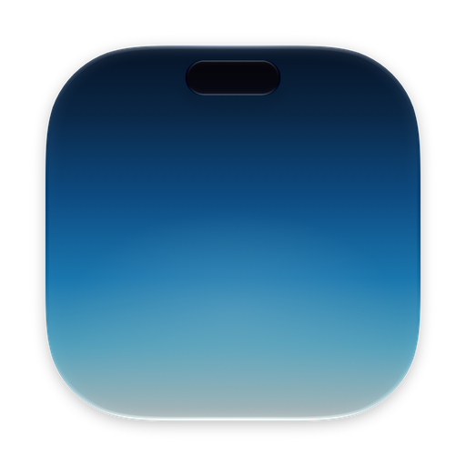
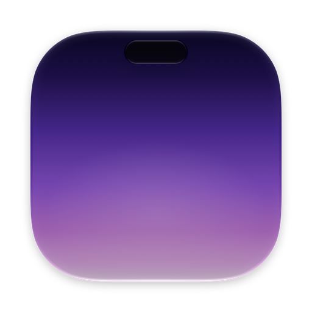
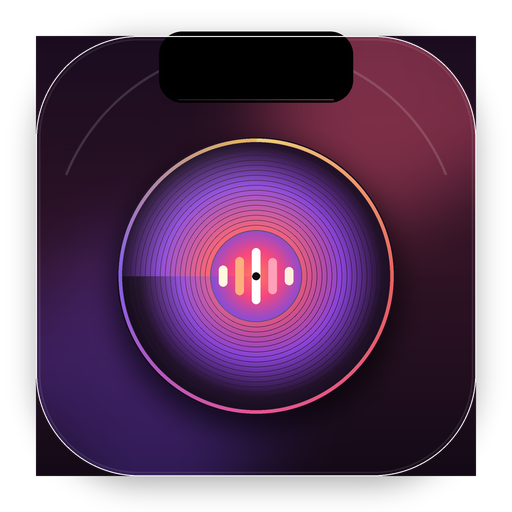
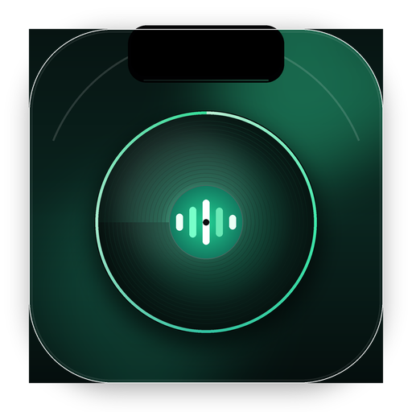
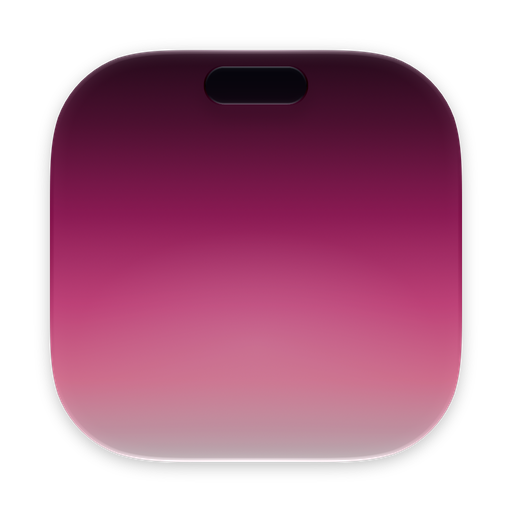

<p align="center">
  
</p>

# NotchMusic

把 MacBook 刘海变成 Apple Music 控制中心的 macOS 应用：播放信息、表盘、日历、系统 HUD 和设备状态都收进刘海里。

> 需要 macOS 14 或更新版本，以及带刘海的内建屏幕。

## 功能

### 刘海音乐面板

- 显示专辑封面、歌曲名、歌手、专辑和播放进度
- 支持上一首、播放/暂停、下一首、随机播放和音量控制
- 支持拖动播放进度，进度条提供默认与 Soft Aurora 两种样式
- 播放控制按钮可自定义排序和显示数量
- 音乐面板支持无表盘的紧凑布局，专辑封面放大，进度条移到工具栏下方
- 播放进度颜色跟随专辑封面主色
- 展开背景提供 8 种动态效果，并可使用封面模糊色和环境光
- 暂停时在封面周围显示柔和的模糊光晕
- 收起状态显示动态均衡器，可选真实音乐频谱

### 表盘与个性化

- 13 种表盘：经典、单行数字、流动、流转、双行数字、欢乐时光、头像、表情、彩虹流光、彩虹和谐、彩虹光辉、彩虹庆典和自定义图片
- 可在音乐界面隐藏表盘，隐藏后自动切换为紧凑音乐布局
- 支持自定义表盘的图片选区，以及表盘显隐动画
- 5 套应用图标：紫罗兰、海洋蓝、日落橙、薄荷绿、玫瑰粉
- 7 种菜单栏图标：刘海、音符、播放列表、多重音符、波形、耳机和唱片
- 调整图标后即时生效，无需重新启动应用

### 系统 HUD 与状态

- 音量、屏幕亮度和键盘背光 HUD
- 两种 HUD 布局：灵动岛和自定义 OSD
- 声音 HUD 支持白色、跟随封面和分贝三种样式
- 灯光 HUD 支持白色、强调色和光晕三种样式，光晕带渐变光柱动画
- 可调 HUD 持续时间、动画速度、百分比、标签和音量/亮度步长
- 支持可选反馈音和触感反馈
- 显示屏幕录制、专注模式、Caps Lock、相机、麦克风和屏幕锁定状态
- AirPods 连接时显示对应 3D 模型、电量和设备信息

### 日历面板

- 在刘海面板中切换音乐和日历两个页面
- 显示月历、选中日期和当天日程
- 日历内容跟随音乐面板宽度，页面切换只做内容滑动

## 应用图标

<table>
  <tr>
    <td align="center"><br>紫罗兰</td>
    <td align="center"><br>海洋蓝（默认）</td>
    <td align="center"><br>日落橙</td>
    <td align="center"><br>薄荷绿</td>
    <td align="center"><br>玫瑰粉</td>
  </tr>
</table>

应用图标和菜单栏图标都可以在「设置 → 通用」中切换。

## 构建

用 Xcode 打开 `NotchMusic.xcodeproj`，选择 `NotchMusic` scheme 后运行。

也可以从命令行构建：

```bash
xcodebuild \
  -project NotchMusic.xcodeproj \
  -scheme NotchMusic \
  -configuration Debug \
  -derivedDataPath .build \
  build
```

构建完成后运行：

```bash
open .build/Build/Products/Debug/NotchMusic.app
```

Release 构建目前面向 Apple Silicon：

```bash
xcodebuild \
  -project NotchMusic.xcodeproj \
  -scheme NotchMusic \
  -configuration Release \
  -derivedDataPath .build-release \
  build
```

## 首次使用

1. 启动 NotchMusic。
2. 在刘海面板或菜单栏菜单中选择“连接 Apple Music”。
3. 在系统提示中允许 NotchMusic 控制 Apple Music。
4. 打开 Apple Music 并播放歌曲。
5. 如需实时频谱，在设置中启用“实时频谱”；首次使用时允许 NotchMusic 捕获系统音频。
6. 如需日历面板，首次打开时允许 NotchMusic 访问日历。

如果误拒绝了权限，可以在“系统设置 → 隐私与安全性 → 自动化”中重新开启。
音频捕获权限可以在“系统设置 → 隐私与安全性 → 音频录制”中重新开启。
日历权限可以在“系统设置 → 隐私与安全性 → 日历”中重新开启。
如需接管音量、亮度和键盘背光按键，还需要在“系统设置 → 隐私与安全性 → 辅助功能”中允许 NotchMusic。

## 实现说明

应用通过 AppleScript 自动化接口读取 Apple Music 的当前曲目信息，并发送上一首、播放/暂停、下一首、播放位置和音量命令。它不会控制其他播放器，也不会使用 `MediaRemote` 等私有 API。

实时频谱使用 macOS 14.2+ 的 Core Audio Process Tap，仅捕获 Apple Music 进程并通过 Accelerate FFT 在本机计算；音频不会保存或上传。屏幕录制状态检测使用事件驱动的 `CGSIsScreenWatcherPresent` 私有接口，仅用于读取录制状态，不访问画面内容。

系统 HUD 使用 Core Audio 控制音量，并通过 DisplayServices 和 CoreBrightness 的未公开接口控制内建屏亮度与键盘背光。媒体键仅在对应 HUD 开启且辅助功能权限可用时拦截，否则保留 macOS 原始行为。

界面和交互参考了 [Boring Notch](https://github.com/TheBoredTeam/boring.notch)，但没有复制其代码。Boring Notch 使用 GPL-3.0 许可证，本项目使用独立的 MIT 实现。

## 限制

- 只有带刘海的内建屏幕会显示面板。
- 仅支持 Apple Music，不支持 Spotify 等其他播放器。
- Release 构建目前仅包含 Apple Silicon（arm64）架构。
- 实时频谱需要 macOS 14.2 或更新版本，并需要用户授予音频捕获权限。
- 日历面板需要用户授予日历访问权限。
- 屏幕录制状态检测依赖未公开的 CoreGraphics 接口，系统升级后可能需要适配。
- 系统 HUD 的亮度与键盘背光控制依赖未公开的系统接口，且外接显示器亮度暂不支持。
- 未签名、未公证的构建可能触发 Gatekeeper 提示。
- 未签名构建的自动化权限可能因重新构建而需要重新授权。
- 当前不包含 App Store 分发配置。
- 当前 Bundle ID 为 `io.github.hoxxxxx.NotchMusic`，版本为 `0.2.0`。

## 许可证

本项目使用 MIT License，详见 `LICENSE`。
