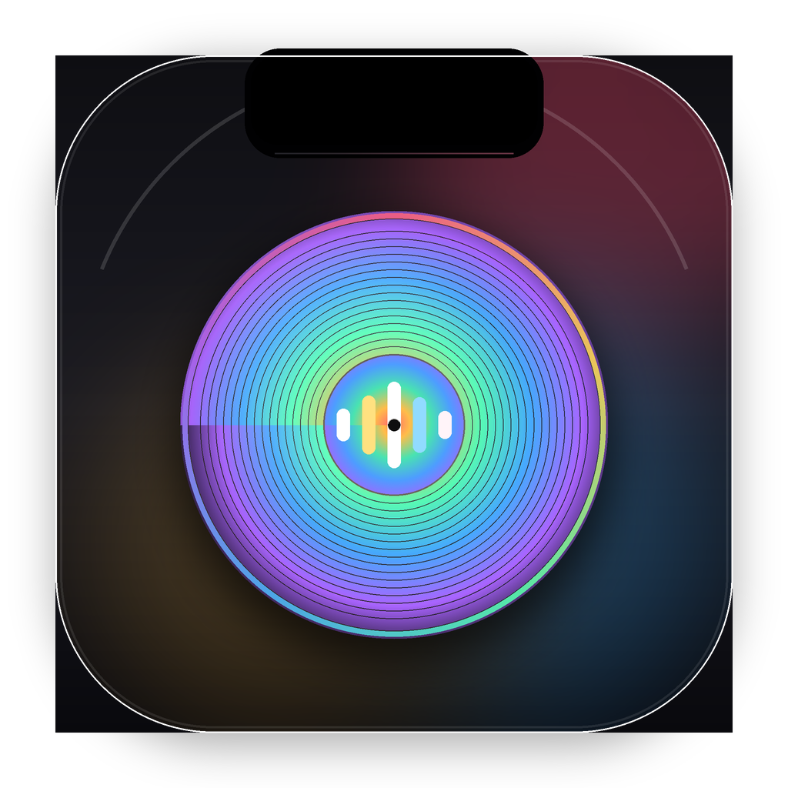

<p align="center">
  
</p>

# NotchMusic

一个在 MacBook 刘海区域显示 Apple Music 当前播放歌曲的开源 macOS 工具。

## 当前 MVP

- macOS 14+
- 仅支持有刘海的内建屏幕
- 仅支持 Apple Music
- 显示封面、歌曲名、歌手、专辑和播放进度
- 支持上一首、播放/暂停和下一首
- 支持拖动播放进度
- 支持调节 Apple Music 音量
- 收起播放状态显示动态均衡器图标
- 可选真实音乐频谱，仅分析 Apple Music 进程，默认关闭
- 播放进度颜色跟随专辑封面主色
- 展开背景使用封面模糊色与环境光
- 展开顶部使用纯黑区域覆盖物理刘海
- 未播放时收起宽度与内建刘海一致
- 鼠标短暂悬停或点击后弹簧展开，移出收起
- 支持经典、数字和彩虹系列等 10 种表盘
- 支持屏幕录制、专注模式、Caps Lock、相机和麦克风状态提示
- 支持音量、内建屏亮度和键盘背光 HUD
- 提供灵动岛、自定义 OSD 和圆形 3 种 HUD 样式
- 声音通知支持 White、Accent、Decibel 三种电平样式，可调持续时间、百分比、标签、动画速度和设备图标
- 支持可选反馈音和自定义音量、亮度按键步长

## 构建

用 Xcode 打开 `NotchMusic.xcodeproj`，选择 `NotchMusic` scheme 后运行。

也可以从命令行构建：

```bash
xcodebuild \
  -project NotchMusic.xcodeproj \
  -scheme NotchMusic \
  -configuration Debug \
  -derivedDataPath .build \
  build
```

构建完成后运行：

```bash
open .build/Build/Products/Debug/NotchMusic.app
```

## 首次使用

1. 启动 NotchMusic。
2. 在刘海面板或菜单栏菜单中选择“连接 Apple Music”。
3. 在系统提示中允许 NotchMusic 控制 Apple Music。
4. 打开 Apple Music 并播放歌曲。
5. 如需实时频谱，在设置中启用“实时频谱”；首次使用时允许 NotchMusic 捕获系统音频。

如果误拒绝了权限，可以在“系统设置 → 隐私与安全性 → 自动化”中重新开启。
音频捕获权限可以在“系统设置 → 隐私与安全性 → 音频录制”中重新开启。
如需接管音量、亮度和键盘背光按键，还需要在“系统设置 → 隐私与安全性 → 辅助功能”中允许 NotchMusic。

## 实现说明

应用通过 AppleScript 自动化接口读取 Apple Music 的当前曲目信息，并发送上一首、播放/暂停、下一首、播放位置和音量命令。它不会控制其他播放器，也不会使用 `MediaRemote` 等私有 API。

实时频谱使用 macOS 14.2+ 的 Core Audio Process Tap，仅捕获 Apple Music 进程并通过 Accelerate FFT 在本机计算；音频不会保存或上传。屏幕录制状态检测使用事件驱动的 `CGSIsScreenWatcherPresent` 私有接口，仅用于读取录制状态，不访问画面内容。

系统 HUD 使用 Core Audio 控制音量，并通过 DisplayServices 和 CoreBrightness 的未公开接口控制内建屏亮度与键盘背光。媒体键仅在对应 HUD 开启且辅助功能权限可用时拦截，否则保留 macOS 原始行为。

界面和交互参考了 [Boring Notch](https://github.com/TheBoredTeam/boring.notch)，但没有复制其代码。Boring Notch 使用 GPL-3.0 许可证，本项目使用独立的 MIT 实现。

## 限制

- 只有带刘海的内建屏幕会显示面板。
- 实时频谱需要 macOS 14.2 或更新版本，并需要用户授予音频捕获权限。
- 屏幕录制状态检测依赖未公开的 CoreGraphics 接口，系统升级后可能需要适配。
- 系统 HUD 的亮度与键盘背光控制依赖未公开的系统接口，且外接显示器亮度暂不支持。
- 未签名、未公证的构建可能触发 Gatekeeper 提示。
- 未签名构建的自动化权限可能因重新构建而需要重新授权。
- 当前不包含 App Store 分发配置。
- 当前 Bundle ID 为 `io.github.hoxxxxx.NotchMusic`。

## 许可证

本项目使用 MIT License，详见 `LICENSE`。
